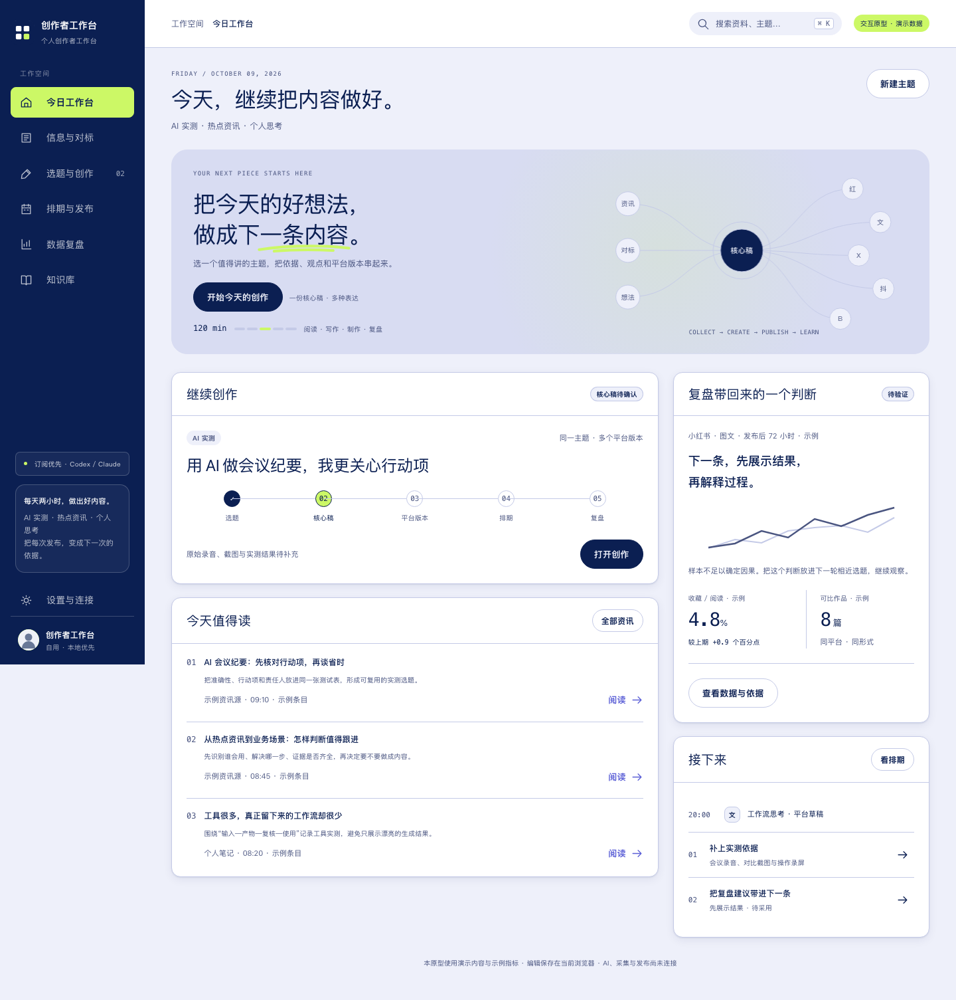
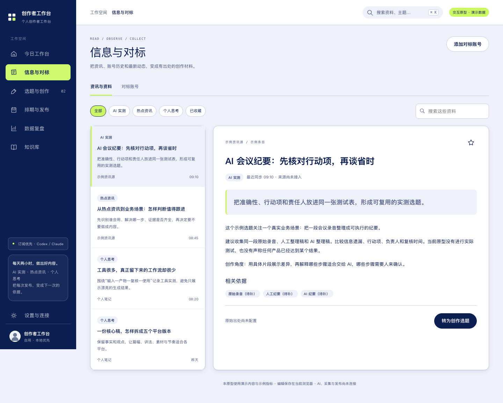

# Personal IP Workbench

**从资料到成稿，把一条内容做完整。**

Personal IP Workbench 是面向个人创作者的本地工作台。把收集的资料、自己的观点、核心稿、不同平台的版本、配图和排期放在同一个创作流程里，再把复盘结果带回下一篇内容。

资料和稿件保存在自己的工作区。你可以先用演示模式体验界面，再按需要连接 AI 执行器、内容来源与平台账号。



> 截图使用合成演示资料与示例指标，不代表真实账号运营结果。

## 可以用它做什么

- **积累有出处的资料**：阅读、收藏和搜索资料，把值得展开的内容关联到创作主题。
- **从自己的观点开始写**：先保存想表达的内容，再形成核心稿，比较 AI 候选、人工修改和历史版本。
- **维护不同平台的表达**：在一个主题下分别编辑小红书、公众号、X、抖音和 B 站的内容版本。
- **管理配图与版式**：整理图片素材、安排文章配图、调整版式；需要生成图片时再接入对应服务。
- **安排发布并保留复盘**：记录排期与发布状态，把采用的复盘意见转成后续创作主题。



## 一条内容怎样完成

资料 → 你的观点 → 核心稿 → 平台版本 → 配图与排期 → 复盘

AI 生成内容先作为候选，由你决定是否采用。核心稿和平台稿分别保存，修改一个平台的文字不会替换其他平台的稿件。

## 快速体验

使用 Node.js 26.9.0 和 pnpm 10.32.1：

```sh
git clone https://github.com/ehomekevin/personal-ip-workbench-open-source.git
cd personal-ip-workbench-open-source
```

在源码根目录运行：

```sh
pnpm install --frozen-lockfile
pnpm dev:web
```

打开终端给出的本地地址。默认演示模式不需要模型或平台凭据。

创建自己的持久化工作区：

```sh
pnpm init:workspace --mode real --dir ./runtime/local --port 4318
pnpm build:web
WORKBENCH_CONFIG_PATH="$(pwd -P)/runtime/local/config.json" \
WORKBENCH_WEB_ROOT="$(pwd -P)/apps/web/dist" \
WORKBENCH_WEB_PORT=5180 \
node scripts/runtime/local-server.ts
```

打开 `http://127.0.0.1:5180/`。`real` 表示连接本地服务，不表示模型和平台已经接通。初始化会创建独立身份和配置，不覆盖已有工作区。

## 按需连接外部能力

基础工作台可以先运行起来。AI 写作需要自行配置执行器或 API；资料采集、生图、语音和发布需要对应服务与账号权限，部分媒体处理需要 ffmpeg / ffprobe。外部服务的订阅、模型和凭据不包含在源码中。

本地优先指工作区和状态保存在本机；启用外部服务后，相应任务输入仍会发送给你配置的服务。多平台稿件编辑不等于所有平台均支持自动发布，实际可用能力以连接状态为准。

## 给开发者

前端使用 React、TypeScript 与 Vite，本地服务使用 Node.js 和 SQLite。业务规则、存储、外部适配器和公共契约分包维护，提供 MCP 与宿主插件入口。

```sh
pnpm ci:check
pnpm build:plugins
pnpm exec playwright install chromium
pnpm test:e2e:portable
```

自有代码采用 MIT，第三方依赖与协议 schema 保留各自许可。模块和开发入口见 `docs/architecture.md`，第三方许可见 `THIRD_PARTY_NOTICES.md`。

详细的本地工作区配置、启动检查和开发方式见 [安装与配置指南](GETTING_STARTED.md)。
